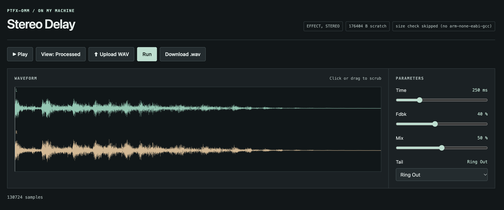

# ptfx on my machine

Develop and test Polyend Tracker `.ptfx` Sample Editor plugins on your own
machine: write the effect in plain C, then run it, tweak its knobs, and
listen to the result in a browser. No Tracker hardware and no ARM
cross-toolchain.



## How it works

A `.ptfx` plugin is C code implementing three entry points
(`plugin_init`, `plugin_set_param`, `plugin_process_block`). The Tracker
feeds it 16-bit PCM blocks and supplies a host API: the sample rate, a
scratch-RAM buffer for delay lines, a `cosf`, and a callback to extend the
output length (for delay tails).

This harness reproduces that host on your desktop:

- `host.c` is the host API, compiled natively. Link it with any plugin and
  you get a command line that reads audio on stdin and writes processed
  audio on stdout.
- `ptfx_omm.py` wraps that binary in a localhost web app: upload a WAV,
  move one slider/select per plugin parameter, hit Run, and view (or
  download) the resulting waveform.

For mono input, stereo-capable effects receive two identical channels. The
result remains mono when those channels are identical, and is stereo when
the effect produces different left and right channels. Stereo input stays
stereo unless the effect explicitly converts it to mono.

Because the exact same C source runs on the desktop and on the device,
what you hear in the browser is what the Tracker will produce.


## Needs a tracker-ce checkout

This folder only holds the dev tools. The actual SDK — `ptfx_builder.py`,
`tracker_plugin.h`, and `effects/*.c` (the reference plugins and your new
ones) — lives in the repo at `../tracker-ce/editor-fx-sdk/` by default.
Override the location with the `PTFX_SDK` env var, e.g.:

```
PTFX_SDK=/path/to/tracker-ce/editor-fx-sdk
```

Official Polyend tracker-ce repo: https://github.com/polyend/tracker-ce

## Install

With [uv](https://docs.astral.sh/uv/) installed:

```
uv sync
```

## Usage

`ptfx_omm.py` will start a browser with a waveform view (raw/processed
toggle, scrub, play) and one slider or select per plugin parameter:

```
uv run ptfx_omm.py ../tracker-ce/editor-fx-sdk/effects/stereo_delay.c
```

Tests (pytest):

```
uv run pytest                      # all tests
uv run pytest test_host.py         # just the host.c native tests
uv run pytest -k add_silence       # by name
```

Requirements: uv, a system C compiler (`cc`) for the native host build. The
ARM size-check in `ptfx_omm.py` is skipped automatically when
`arm-none-eabi-gcc` is not available.

Note: this harness produces native host binaries for testing only. Real
hardware `.ptfx` files are built by the tracker-ce repo (`make ptfx`, CI
artifact `polyend-tracker-ce-effects`).
